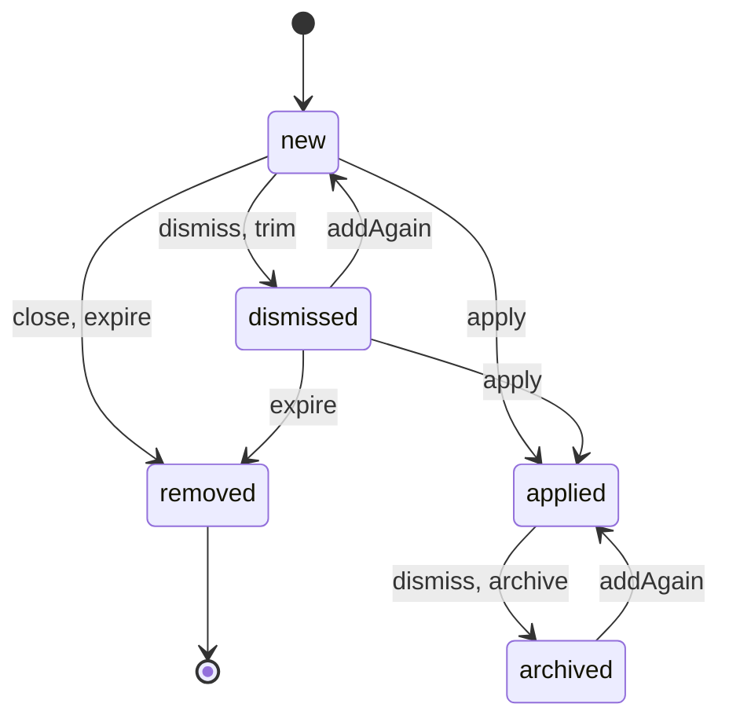
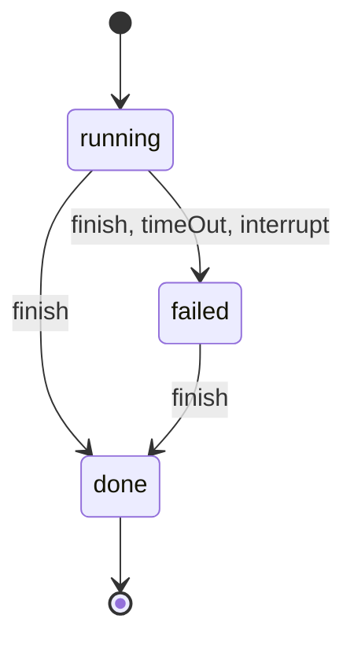
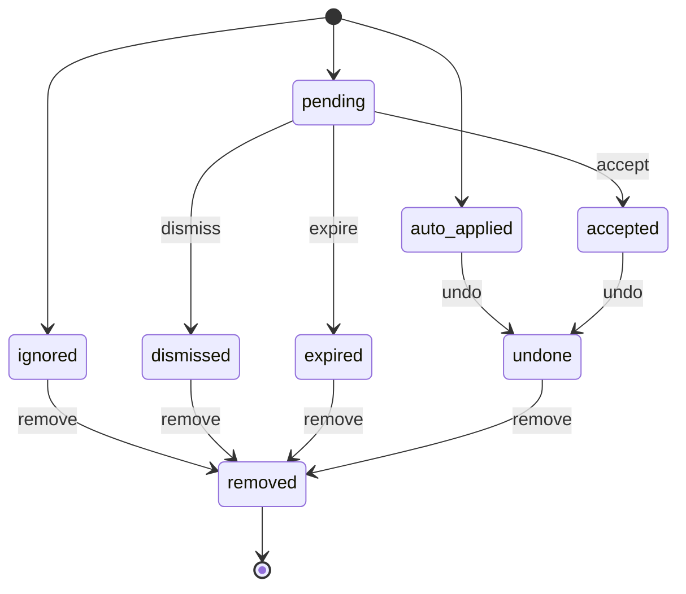
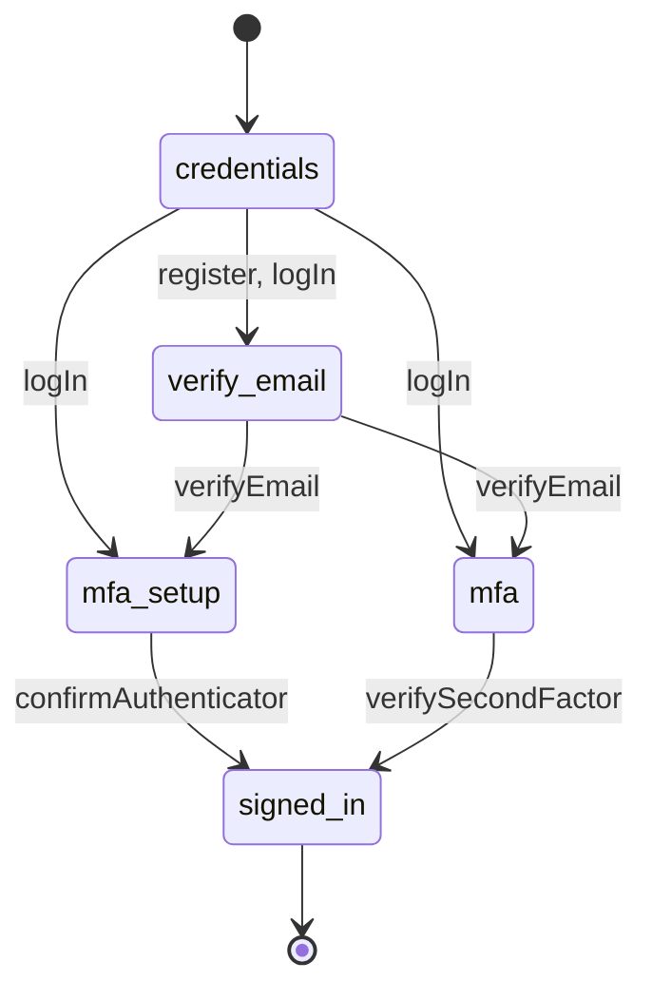
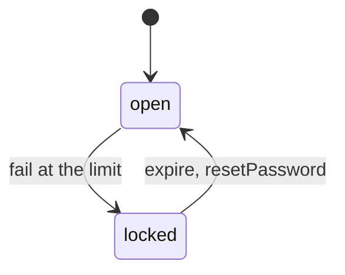
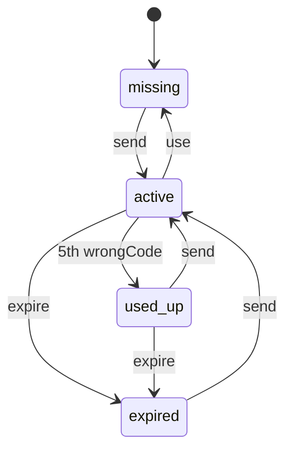
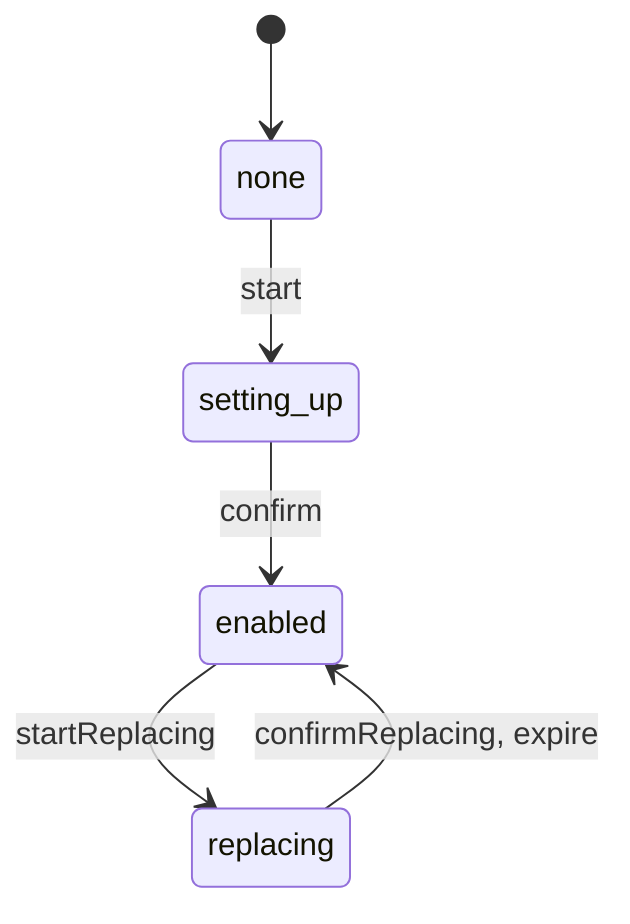
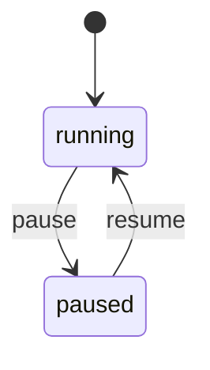
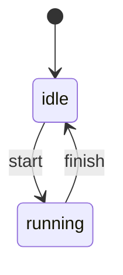

# Backend state machines

Anything in the backend that moves through steps or statuses is declared as a table, and every change goes through it.
This page lists each table, what moves it and the rules around it. The frontend's tables are in
[frontend/STATE_MACHINES.md](../frontend/STATE_MACHINES.md).

## The helper

[`services/shared/stateMachine.js`](src/services/shared/stateMachine.js)

```js
const DOOR = createMachine("door", {
  initial: "closed",
  states: {
    closed: { open: "open", lock: "locked" },
    open: { close: "closed" },
    locked: { unlock: ["closed", "locked"] }   // a list: the caller picks one
  }
});
```

| Function | Returns |
|---|---|
| `next(state, move, pick)` | The state the move leads to, or `null` if the move isn't allowed |
| `move(state, move, pick)` | The same, but throws a `TransitionError` instead of returning `null` |
| `can(state, move, pick)` | Whether the move is allowed |
| `sources(move)` | The states the move can start from |
| `targets(move)` | The states the move can lead to |
| `sqlList(states)` | The states quoted for SQL (`'a', 'b'`); refuses anything that isn't a state in the table |
| `name`, `initial`, `states` | The table's name, starting state (or list of them) and state names |

- **List moves.** When the next state depends on data the table doesn't hold (an account's setup, a score), the move
  lists the allowed states and the caller passes the one it chose as `pick`. A pick that isn't listed is refused.
- **Checked when built.** `createMachine` throws if a move leads to a state that isn't in the table, if the starting
  state is unknown, or if a state name isn't plain letters and underscores. That last check is what makes `sqlList`
  safe to put in SQL.
- **In SQL.** Queries take their state names from the table (`sources`, `targets`, `sqlList`, or the jobs helpers
  below), never from hand-written strings. A guard such as `WHERE status IN (…sources("finish"))` makes the database
  refuse the move, even when two requests race.

## Index

| Table | File | Stored in |
|---|---|---|
| [`JOB`](#jobs-job) | [`services/jobs/jobStates.js`](src/services/jobs/jobStates.js) | `jobs.state` + `jobs.hidden` |
| [`SEARCH`](#job-searches-search) | [`services/jobs/jobStates.js`](src/services/jobs/jobStates.js) | `job_searches.status` |
| [`EMAIL_EVENT`](#email-events-email_event) | [`services/email/emailService.js`](src/services/email/emailService.js) | `email_events.state` |
| [`EMAIL_MOVES`](#application-status-from-email-email_moves) | [`services/email/emailMatcher.js`](src/services/email/emailMatcher.js) | `applications.status` |
| [`SIGN_IN`](#sign-in-sign_in) | [`services/auth/authStates.js`](src/services/auth/authStates.js) | The `pending_auth` cookie (`stage`) |
| [`LOCKOUT`](#lockouts-lockout) | [`services/auth/authStates.js`](src/services/auth/authStates.js) | `users.*_failed_attempts` + `users.*_locked_until` |
| [`EMAIL_CODE`](#emailed-codes-email_code) | [`services/auth/authStates.js`](src/services/auth/authStates.js) | `email_verifications`, `password_resets` |
| [`AUTHENTICATOR`](#authenticator-authenticator) | [`services/auth/authStates.js`](src/services/auth/authStates.js) | `users.totp_enabled`, `totp_secret`, `totp_pending_secret`, `totp_pending_at` |
| [`OUTAGE`](#logo-lookup-pause-outage) | [`services/logos/logoService.js`](src/services/logos/logoService.js) | Memory |
| [`PREFETCH`](#logo-prefetch-prefetch) | [`services/logos/logoPrefetch.js`](src/services/logos/logoPrefetch.js) | Memory |

## Jobs (`JOB`)

A job on the Jobs page, whether a search found it or the user added it.



> Not drawn, since they keep the state: `addAgain` on a new or applied job, and `dismiss` on an archived one

**States and columns.** The table has two columns behind it, so each state is a pair:

| State | `state` | `hidden` | Meaning |
|---|---|---|---|
| `new` | `new` | false | On the Jobs page, not acted on |
| `dismissed` | `dismissed` | false | Dismissed by the user, or trimmed |
| `applied` | `applied` | false | Applied to, shown in the Jobs page's Applied section |
| `archived` | `applied` | true | Applied to, hidden from the Jobs page, but kept with its resume for the Applications page |
| `removed` | — | — | The row is deleted |

> Only an applied job can be hidden: the `jobs_hidden_check` constraint in `schema.sql` enforces it, so these four
> pairs cover every row

**Moves.**

| Move | From → To | Made by |
|---|---|---|
| `dismiss` | new → dismissed, applied → archived, archived → archived | `POST /jobs/:id/dismiss`, `POST /jobs/dismiss-all` |
| `trim` | new → dismissed | `trimFound` after a search: found jobs past `MAX_FOUND_JOBS` (300), weakest first |
| `apply` | new or dismissed → applied | `POST /jobs/:id/apply` (409 if the job is already applied or archived) |
| `archive` | applied → archived | `POST /jobs/:id/apply`: applied jobs past `MAX_APPLIED_JOBS` (100), oldest first |
| `addAgain` | dismissed → new, archived → applied, others stay | `POST /jobs` with a link the user already has; the job becomes hand-added |
| `close` | new → removed | Found jobs whose posting closed: `recheckFound` before a search, and `removeClosedJobs` |
| `expire` | new or dismissed → removed | `removeOldPostings` in the daily cleanup: found new jobs and dismissed jobs of any source, posted (or added) more than `MAX_AGE_DAYS` (90) ago; a dismissed job only once its posting is gone from the feed |

> • `dismiss-all` narrows the move to one section: `found` touches only `new` jobs, `applied` touches `applied` and
>  `archived` ones<br>
> • `dismiss` on an archived job is allowed and changes nothing, so the request still succeeds<br>
> • `expire` runs on the same 90 days as the job postings themselves. A dismissed job also waits until its posting is
>  gone from the feed (a posting seen again gets a new first-seen date), so a search can't bring it back. Hand-added
>  new jobs never expire<br>
> • `addAgain` sets `source` to `manual`, so a found job the user adds by hand is no longer trimmed, closed or
>  expired as a found one<br>
> • The 2000-job limit on hand-added jobs counts only `VISIBLE` ones, so dismissing a job frees a place

**Helpers** (in `jobStates.js`) build the SQL from the table, so no query spells out the column pairs by hand:

| Helper | Builds | Example |
|---|---|---|
| `inStates(states, table?)` | A condition for jobs in any of the states | `((state = 'new' AND NOT hidden))` |
| `canMove(move, { only, table }?)` | A condition for jobs the move can start from, optionally narrowed | `canMove("dismiss", { only: ["new"] })` |
| `moveSet(move, table?)` | A `SET` clause moving each job by the state it's in (one `CASE` per column) | `UPDATE jobs SET ${moveSet("dismiss")} WHERE …` |
| `jobState(row)` | The state of a loaded row (needs `state` and `hidden`) | Used by apply, after `SELECT … FOR UPDATE` |
| `VISIBLE` | The states the Jobs page lists | `["new", "applied"]` |

> Pass `table` when the columns need a table name, as in `ON CONFLICT … DO UPDATE` (`moveSet("addAgain", "jobs")`).

## Job searches (`SEARCH`)

One background search for new jobs.



> Not drawn, since it keeps the state: `finish` as `failed` on a failed search

| Move | Made by |
|---|---|
| start (`initial`) | `start()` inserts the row as `running` |
| `finish` (pick `done` or `failed`) | `run()` when the search ends; `finish()` refuses any other pick |
| `timeOut` | `status()`: a search running for more than `STALE_MINUTES` (5) |
| `interrupt` | `failInterrupted()` on server start: searches left running by a restart |

> • A search marked failed for taking too long can still finish later and record what it found. This is why `failed` has a `finish` move. A `done` search never changes<br>
> • The partial unique index `job_searches_one_running_idx` (schema.sql) allows one `running` search per user. Its `WHERE status = 'running'` must match the table's starting state<br>
> • What the API reports is derived from the latest rows, not stored: `running`, `canRefresh` (not running, and fewer than 10 searches in the last hour, not counting failed ones), `lastError` and `lastFailedAt` (the latest search failed)

## Email events (`EMAIL_EVENT`)

One job-related email from Gmail sync, and what happened to the update it suggested.



**Starting state.** `recordOutcome` in `emailService.js` picks one of the three starting states, and
`insertEvent` refuses any other:

| Starting state | When |
|---|---|
| `ignored` | Not job-related; no status for the event type; confidence below `MIN_CONFIDENCE` (0.5); the email predates the application; or `EMAIL_MOVES` ignores the change for every candidate |
| `pending` | No matching application; several possible matches (`candidate_ids`); or a match that isn't confident enough for an automatic change |
| `auto_applied` | Auto-update is on, `EMAIL_MOVES` says `auto`, the match is sure, the company score is at least `AUTO_COMPANY_SCORE` (0.9) and confidence is at least `AUTO_CONFIDENCE` (0.85). The application's status changes in the same transaction, and `previous_status` keeps the old one |

**Moves.** All three routes lock the event (`lockEvent`) and answer 409 "already handled" when the table doesn't
allow the move from its current state.

| Move | Route | Also |
|---|---|---|
| `accept` | `POST /email/events/:id/accept` | Sets the application's status; asks the user to choose an application when the event has several candidates; 409 when `EMAIL_MOVES` would now ignore the change (the status moved on since) |
| `dismiss` | `POST /email/events/:id/dismiss` | — |
| `undo` | `POST /email/events/:id/undo` | Restores `previous_status`, only if the application's status is still the suggested one (409 otherwise) |
| `expire` | `cleanUpEvents` in the daily cleanup | Pending events recorded more than `PENDING_DAYS` (30) ago; sets `resolved_at` |
| `remove` | `cleanUpEvents` in the daily cleanup | Deletes ignored, dismissed, undone and expired events resolved (or, for ignored ones, recorded) more than `KEEP_DAYS` (90) ago |

> • A pending event is either a dashed card (no single matching application) or a suggestion on an application's
>  card, both under Needs your review. Expiring takes it off the page<br>
> • `accepted` and `auto_applied` events are never removed: they're the record of which email changed a status, and
>  from what. They're a small share of the rows<br>
> • Events are the record of which emails were already processed, so Gmail sync skips them. Removing them after 90
>  days is safe because the sync script looks back 45 days at most (on its first run), so a removed email is never
>  sent again<br>
> • The 300-a-day limit on processed emails counts events recorded in the last 24 hours, so cleanups don't affect it<br>
> • `email_events_state_check` in `schema.sql` lists the stored states; `removed` isn't one, since the row is deleted

**Lists.** `GET /email/events` builds its lists from the table:

- **Pending:** events that can be accepted, unless their application's current status makes the change one `EMAIL_MOVES` ignores (already there, or moved past it). The condition comes from `movesStatusSql`.
- **Recent:** events that can be undone, resolved in the last 24 hours, with `undoable` set when the status hasn't changed since.

## Application status from email (`EMAIL_MOVES`)

Which status changes an email update may make. This isn't a `createMachine` table, because each entry is a decision
rather than a next state.

| From \ To | Interview | Offer | Rejected |
|---|---|---|---|
| Applied | auto | auto | auto |
| Interview | — | auto | auto |
| Offer | — | — | review |
| Rejected | — | — | — |
| Withdrawn | — | — | — |

- **auto:** applied automatically when the match is confident (see the `auto_applied` row above).
- **review:** always waits for the user (`pending`), so an offer is never rejected automatically.
- **—:** ignored. This covers moving backwards, staying in place, anything from Rejected or Withdrawn, and email
  never suggesting Applied or Withdrawn.

`transition(current, target)` reads the table, and `movesStatusSql(current, target)` builds the same rule as an SQL condition. Hand edits aren't limited by it: the user can set any of the five
`STATUSES` from the application form.

## Sign-in (`SIGN_IN`)

A sign-in that isn't finished yet. The current step is the `stage` in the `pending_auth` cookie, which lasts
15 minutes and becomes invalid when `token_version` changes.



> Not drawn, since they keep the step: `resendCode` on `verify_email`, and `startAuthenticator` on `mfa_setup`

| Move | Route |
|---|---|
| `register` | `POST /auth/register` |
| `logIn` (pick from `nextStage`) | `POST /auth/login` |
| `verifyEmail` (pick from `nextStage`) | `POST /auth/verify-email` |
| `resendCode` | `POST /auth/resend-verification` |
| `startAuthenticator` | `POST /auth/mfa/setup` |
| `confirmAuthenticator` | `POST /auth/mfa/setup/confirm` (starts the session) |
| `verifySecondFactor` | `POST /auth/mfa/verify` (starts the session) |

> • **Route guard.** Each route mounts `requirePending(move)`, which only accepts a cookie whose stage is one of `SIGN_IN.sources(move)`. It answers 401 with `restart: true` otherwise. Naming a move that isn't in the table throws when the routes load<br>
> • **`nextStage(user)`.** It walks `SETUP_STEPS` in order and returns the first step the account hasn't done: `verify_email` until the email is verified, then `mfa_setup` until the authenticator is on, then `mfa`<br>
> • **Password reset** isn't part of this table. It works through emailed codes and ends every session<br>
> • The frontend's login page follows the same steps in `SIGN_IN_STEPS`. Keep the two in step

## Lockouts (`LOCKOUT`)

Too many failed attempts lock sign-in, or the second factor, for a while.



> Not drawn, since they keep it open: `fail` under the limit (counts the attempt), `succeed` and `resetPassword` (both clear the count)

| Kind | Attempts column | Lock column | Limit | Lock |
|---|---|---|---|---|
| `login` | `failed_login_attempts` | `login_locked_until` | 10 | 15 minutes |
| `mfa` | `mfa_failed_attempts` | `mfa_locked_until` | 5 | 15 minutes |

> These settings live in `LOCKS`

| Function | Does |
|---|---|
| `lockState(until)` | Returns `locked` while the lock time is in the future. `expire` happens on its own, by the clock |
| `lockedMessage(until)` (authService) | Returns the "try again in N minutes" message while locked |
| `recordFailure(userId, kind)` (authService) | Makes the `fail` move in one atomic `UPDATE`: counts up, or locks and resets the count |
| `unlockSql(kind)` | The `SET` fragment that clears the lock and count; used on success and on password reset |

> • **mfa** failures come from the 2FA code, the setup code, the authenticator reset (password or code) and account deletion. Each of those routes checks `lockedMessage` first<br>
> • While locked, routes refuse before checking anything, so no `fail` or `succeed` happens in `locked`<br>
> • A password reset clears the `login` lock only

## Emailed codes (`EMAIL_CODE`)

The 6-digit codes for verifying an email (`email_verifications`) and resetting a password (`password_resets`).
Each table has one row per user.



> Not drawn, since they keep it active: `send` (a fresh code) and a `wrongCode` with tries left

`codeState(row)` reads a row:

| State | Row |
|---|---|
| `missing` | No row |
| `expired` | `expires_at` has passed (15 minutes after sending) |
| `used_up` | Not expired, `attempts` at `EMAIL_CODE_MAX_ATTEMPTS` (5) |
| `active` | Not expired, tries left |

**`sendEmailCode`:**

- **Resend wait.** It won't send while an `active` code is under 60 seconds old. A `used_up` code isn't protected by the wait.
- **Keep the code.** Without `force`, it keeps an `active` code (login does this; the resend route forces). A `used_up` code is always replaced, right away.
- **Daily limit.** It sends at most 8 codes per user in 24 hours, `used_up` replacements included.
- **Fresh code.** Sending replaces the row with a new code and resets `attempts`.

> These limits are separate from the table: they decide whether a `send` happens at all

**`checkEmailCode`:**

| State | Answer |
|---|---|
| `missing` or `expired` | 400, "This code has expired" |
| `used_up` | 429, "Too many attempts" |
| `active`, wrong code | Counts the attempt (`wrongCode`) |

> After a correct code, the route deletes the row (`use`)

## Authenticator (`AUTHENTICATOR`)

The user's TOTP authenticator app.



> Not drawn, since they keep the state but replace the secret: `start` while setting up, and `startReplacing` while replacing

`authenticatorState(user)` reads the account:

| State | `totp_enabled` | `totp_secret` | `totp_pending_secret` and `totp_pending_at` |
|---|---|---|---|
| `none` | false | empty | — |
| `setting_up` | false | set | — |
| `enabled` | true | set | Empty, or a replacement started 15 minutes ago or more (or with no start time) |
| `replacing` | true | set | A replacement started less than 15 minutes ago |

| Move | Route | Also |
|---|---|---|
| `start` | `POST /auth/mfa/setup` | Stores a new secret; each call replaces the last one |
| `confirm` | `POST /auth/mfa/setup/confirm` | Enables 2FA, creates recovery codes, starts the session |
| `startReplacing` | `POST /account/mfa/reset/start` | After the password and current second factor check out; stores the new secret as pending, with its start time |
| `confirmReplacing` | `POST /account/mfa/reset/confirm` | Swaps in the pending secret, replaces recovery codes, ends every other session |
| `expire` | By the clock, `REPLACE_AUTHENTICATOR_MINUTES` (15) after `startReplacing` | The next confirm attempt removes the pending secret and answers "This authenticator reset expired" with `expired: true`, which sends the Account panel back to its first step |

> • While replacing, the old authenticator keeps working until the new one is confirmed<br>
> • The time limit keeps an abandoned reset from staying open: confirming needs only a signed-in session, so a hijacked session with a stale pending secret could otherwise replace 2FA without the password<br>
> • Starting again replaces the pending secret and restarts the 15 minutes

## Logo lookup pause (`OUTAGE`)

Company logo lookups (Logo.dev and Claude) stop for a while after repeated failures. This keeps an outage from using
up allowances or flooding the logs.



> Not drawn, since it keeps it paused: `pause` while paused, which extends the pause. `resume` happens when the pause time is up

> • `noteOutcome(error)` counts failures in a row and makes the `pause` move at `OUTAGE_AFTER` (3), for `OUTAGE_PAUSE_MS` (60s)<br>
> • A success resets the count. A request Claude declined, or a daily limit, doesn't count as a failure<br>
> • `outageState()` reads the state from the clock, so `resume` happens on its own<br>
> • Lookups finishing during a pause still count, and can extend it<br>
> • While paused, `paused()` is true: lookups are skipped, old cached logos are still served, and the feed prefetch stops

## Logo prefetch (`PREFETCH`)

The background job that looks up logos for companies in the job feed after a feed refresh.



> • `prefetchLogos()` returns `null` straight away when a prefetch is already running, or when logos aren't configured<br>
> • `finish` runs in a `finally`, so a failed prefetch doesn't block the next one<br>
> • The state is per process

## Adding or changing a table

1. **Edit the table** and its comment. `createMachine` checks the table when the module loads.
2. **Change state through the table:** `move` or `can` in code, `sources`, `targets`, `sqlList` or the jobs helpers in SQL.
3. **Stored states.** If the state is stored, check the column's `CHECK` constraints (such as `jobs_hidden_check`) and any partial index in
   `schema.sql`. Both list state names by hand.
4. **Tests.** Update the table's tests (`__tests__/jobStates.test.js`, `authStates.test.js`, `emailService.test.js`,
   `emailMatcher.test.js`). If a route's behavior changes, update its database test too.
5. **This page.** Update it, along with the frontend's page if the change shows there.
