# Frontend state machines

Any UI state in the frontend that moves through steps is declared as a table, and components change it only through
the table. This page lists each table, what moves it and what the UI shows in each state. The backend's tables are in
[backend/STATE_MACHINES.md](../backend/STATE_MACHINES.md).

## The helper and the hook

[`lib/stateMachine.js`](src/lib/stateMachine.js) builds a table the same way the backend's helper does:

```js
export const LIGHT = createMachine("light", {
  initial: "off",
  states: {
    off: { switchOn: ["dim", "bright"] },     // a list: the caller picks one
    dim: { switchOff: "off" },
    bright: { switchOff: "off" }
  }
});
```

It offers `next(state, move, pick)` (the next state, or `null` if the move isn't allowed), `can`, `sources`, `name`,
`initial` and `states`. It throws when it's built if a move leads to an unknown state or the starting state is unknown.

[`hooks/useMachine.js`](src/hooks/useMachine.js) keeps a table's state in a component:

```jsx
const [light, sendLight] = useMachine(LIGHT); // or useMachine(LIGHT, "dim") to start elsewhere

sendLight("switchOn", "bright");              // pick for a list move
sendLight("switchOff");
```

- **Disallowed moves.** A move the table doesn't allow is ignored: the state stays the same. In development, the hook
  also logs `light: "switchOff" isn't allowed from "off"`. A warning like that in the console means the code and the
  table disagree.
- **Stable `send`.** `send` is the same function on every render, so it can go in hook dependency lists without
  re-running anything.
- **Data lives outside.** A table holds only the state name. Data that goes with a state is kept in ordinary state
  next to it, such as the job a dialog shows or the application being edited.

## Index

| Table | File | Used in |
|---|---|---|
| [`API_HEALTH`](#server-health-api_health) | [`utils/auth/authMachines.js`](src/utils/auth/authMachines.js) | `App.jsx` |
| [`SESSION`](#session-session) | [`utils/auth/authMachines.js`](src/utils/auth/authMachines.js) | `App.jsx` |
| [`SIGN_IN_STEPS`](#sign-in-page-sign_in_steps) | [`utils/auth/authMachines.js`](src/utils/auth/authMachines.js) | `pages/Login.jsx` |
| [`AUTHENTICATOR_RESET`](#authenticator-reset-authenticator_reset) | [`utils/auth/authMachines.js`](src/utils/auth/authMachines.js) | `pages/Account.jsx` (`ResetAuthenticatorPanel`) |
| [`ACCOUNT_PANEL`](#account-panels-account_panel) | [`utils/auth/authMachines.js`](src/utils/auth/authMachines.js) | `pages/Account.jsx` |
| [`APPLICATION_EDITOR`](#application-form-application_editor) | [`utils/applications/applicationMachines.js`](src/utils/applications/applicationMachines.js) | `pages/Applications.jsx` |
| [`NOTE`](#application-note-note) | [`utils/applications/applicationMachines.js`](src/utils/applications/applicationMachines.js) | `components/applications/ApplicationForm.jsx` |
| [`APPLICATION_STATUS`](#application-status-journey-application_status) | [`utils/applications/applicationMachines.js`](src/utils/applications/applicationMachines.js) | `components/applications/StatusStack.jsx`, `ApplicationForm.jsx` (rules only; the steps live on the server) |
| [`STATUS_STACK`](#status-area-folds-status_stack) | [`utils/applications/applicationMachines.js`](src/utils/applications/applicationMachines.js) | `components/applications/StatusStack.jsx` |
| [`STEP_ACTION`](#status-area-page-actions-step_action) | [`utils/applications/applicationMachines.js`](src/utils/applications/applicationMachines.js) | `components/applications/StatusStack.jsx` |
| [`JOB_MODAL`](#jobs-page-dialogs-job_modal) | [`utils/jobs/jobMachines.js`](src/utils/jobs/jobMachines.js) | `pages/Jobs.jsx` |
| [`TAILOR`](#tailored-resume-tailor) | [`utils/resume/resumeMachines.js`](src/utils/resume/resumeMachines.js) | `components/jobs/TailorModal.jsx` |
| [`RESUME_FILE`](#profile-resume-and-grade-sheet-resume_file-grade_sheet) | [`utils/resume/resumeMachines.js`](src/utils/resume/resumeMachines.js) | `components/jobs/ProfileModal.jsx` |
| [`GRADE_SHEET`](#profile-resume-and-grade-sheet-resume_file-grade_sheet) | [`utils/resume/resumeMachines.js`](src/utils/resume/resumeMachines.js) | `components/jobs/ProfileModal.jsx` |

## Server health (`API_HEALTH`)

Whether the server can be reached.

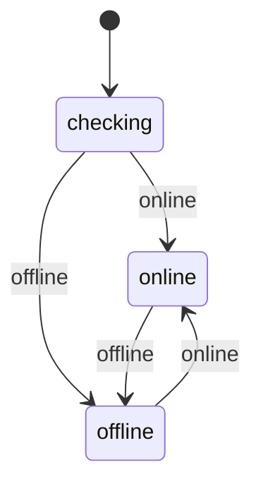

> Not drawn, since they keep the state: `online` while online, and `offline` while offline

- **On load.** `online` when `/api/health` answers `ok`; `offline` when it answers anything else, or doesn't
  answer at all.
- **After that.** Every API request reports whether the server answered (`onReachability` in `lib/api.js`, which
  `App.jsx` listens to). A request that gets no answer, or a 502, 503 or 504 from the host in front of the server,
  means `offline`; any other answer, errors included, means `online`. No extra requests are made just to check.
- **Where it shows.** The footer's server pill shows the state. The login form warns while `offline`.

## Session (`SESSION`)

Whether the user is signed in. It's separate from server health, because a server that answers "not ok" still gets
a session restore attempt.

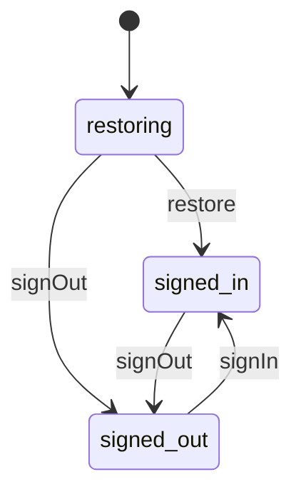

> Not drawn, since they keep the state: `signIn` while restoring or signed in, and `signOut` or `restore` while signed out

| Move | Made by |
|---|---|
| `restore` | `initialize()`, after the CSRF token, user and applications have all loaded |
| `signIn` | `completeLogin()` after the sign-in page finishes, and `loadApps()` whenever applications load |
| `signOut` | `clearSession()`: logout, account deletion, any 401, a failed restore, or no server at all on load |

- **While `restoring`.** Protected pages (`/applications`, `/jobs`, `/account`) show a loading spinner, and no
  redirect happens. `signIn` keeps it `restoring`, so data that loads early can't end the restore before the
  applications are in (that would briefly show an empty list).
- **A late restore.** A `restore` that arrives after a 401 has already signed the user out does nothing.
- **Redirects.** Once settled, a protected page without a session goes to `/login`, and `/login` or `/signup` with a
  session goes to `/applications`.
- **Email updates.** They reload every 2 minutes, and when the tab becomes visible again, only while `signed_in` and on
  `/applications`.

## Sign-in page (`SIGN_IN_STEPS`)

The steps of `/login` and `/signup`. It follows the backend's `SIGN_IN` table, plus steps that only happen on this
page (the recovery codes and resetting a password).

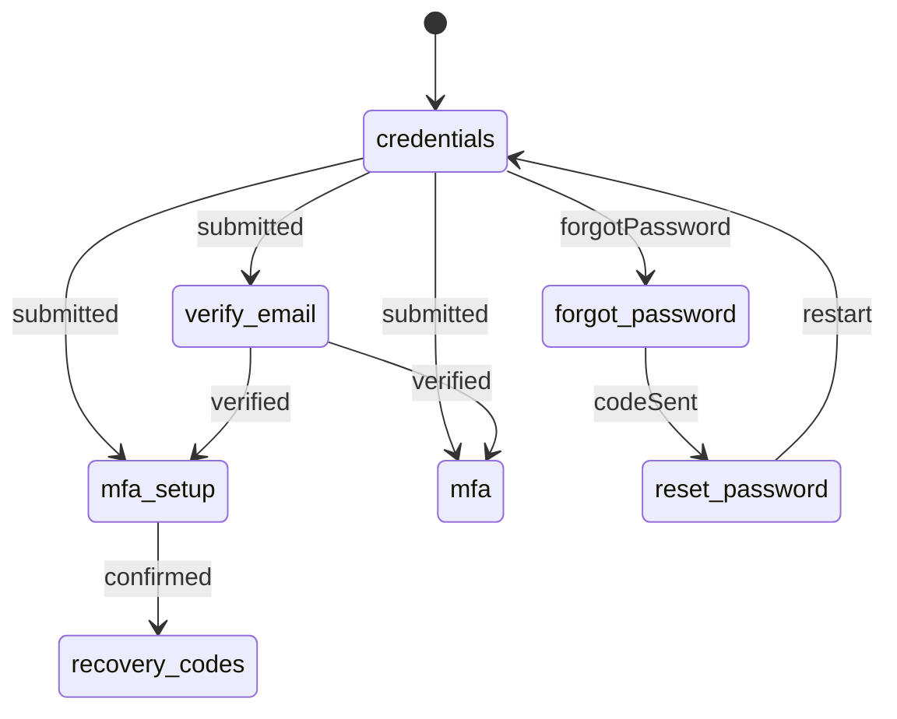

> Not drawn, to keep the diagram readable: `restart` also leads back to `credentials` from every other step except `recovery_codes` (and keeps `credentials` as it is)

| Step | Shows | Leaves by |
|---|---|---|
| `credentials` | Email and password form, log in / sign up tabs | `submitted` with the server's `next`; `forgotPassword` |
| `verify_email` | `VerifyEmailStep` | `verified` with the server's `next` |
| `mfa_setup` | `MfaSetupStep` (QR code and code) | `confirmed` |
| `recovery_codes` | `RecoveryCodesStep` | Continue: signs in and leaves the page |
| `mfa` | `MfaVerifyStep` (code or recovery code) | A correct code signs in and leaves the page |
| `forgot_password` | `ForgotPasswordStep` | `codeSent` |
| `reset_password` | `ResetPasswordStep` | `restart` with a success message |

- **Server-chosen steps.** `submitted` and `verified` only accept the steps the server can send. An unexpected `next`
  leaves the page where it is.
- **`restart`.** The Back button, any request the server answers with `restart: true` (an expired or wrong-step
  sign-in), and a finished password reset all restart. Restarting clears the password fields and the
  recovery-code mode.
- **Recovery codes.** There's no way back from `recovery_codes`: the codes are shown once, and the Back button is
  hidden there.

## Authenticator reset (`AUTHENTICATOR_RESET`)

The Account page's panel for moving 2FA to a new authenticator app (the backend's `startReplacing` and
`confirmReplacing`).

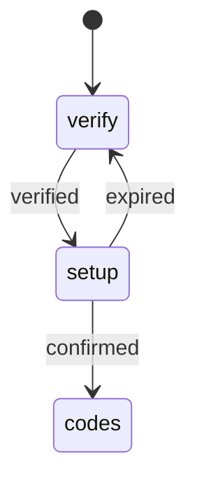

| Step | Shows |
|---|---|
| `verify` | Password and current second factor; `verified` when `/account/mfa/reset/start` accepts them |
| `setup` | The new QR code; `confirmed` when `/account/mfa/reset/confirm` accepts a code from the new app, which must happen within 15 minutes of `verified` |
| `codes` | The new recovery codes; Done closes the panel |

> • Cancel closes the panel from `verify` or `setup`. The old authenticator keeps working<br>
> • After 15 minutes in `setup`, the server answers "This authenticator reset expired. Please start it again." with
>  `expired: true`. `MfaSetupStep` passes it to `onExpired`, and the panel goes back to `verify` (`expired`) with the
>  message, cleared fields and no QR code

## Account panels (`ACCOUNT_PANEL`)

The Account page opens one settings panel at a time.

| State | Panel |
|---|---|
| `closed` | None |
| `codes` | New recovery codes |
| `authenticator` | Authenticator reset (above) |
| `delete` | Account deletion |
| `email` | Gmail sync setup |
| `emailDisconnect` | Confirming Gmail sync disconnection |

- **Moves.** `open` (pick the panel) works from any state, since the other panels' buttons stay visible and opening
  one replaces the current one. `close` works from any state.
- **Finishing a panel.** `closePanel(message)` closes it, shows a success message and reloads the settings.

## Application form (`APPLICATION_EDITOR`)

The form dialog on the Applications page.

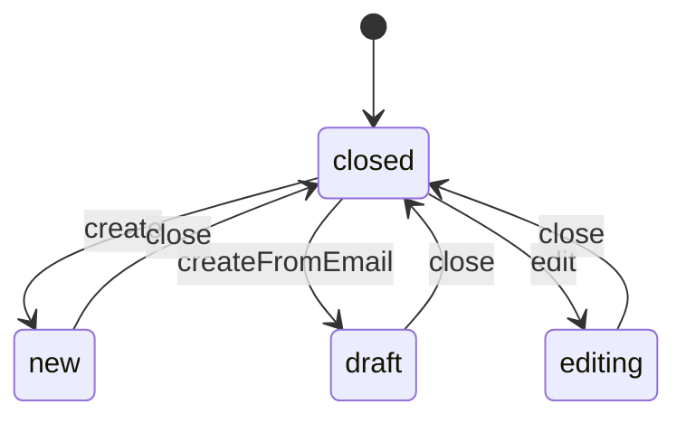

| State | Opened by | Shows | Saving |
|---|---|---|---|
| `new` | The New buttons (`createEntry`) | "New" with an application / job post switch | Creates an application, or adds a job post and goes to `/jobs` |
| `draft` | "Add as a new application" on an email update (`addFromUpdate`) | "New Application", filled in from the email | Creates the application, then dismisses the email update |
| `editing` | A card's edit button, or a tap on a card on phones (`editApplication`) | "Edit Application" | Updates the application |

- **Data.** `editing` holds the application, or the email's details for a draft.
- **Closing.** `closeEditing()` closes the form and resets the switch to applications.
- **One at a time.** A form can't switch to another while open; the dialog covers the buttons that would do it.

## Application note (`NOTE`)

The note field of the application form, and whether the duplicate warning wrote it.

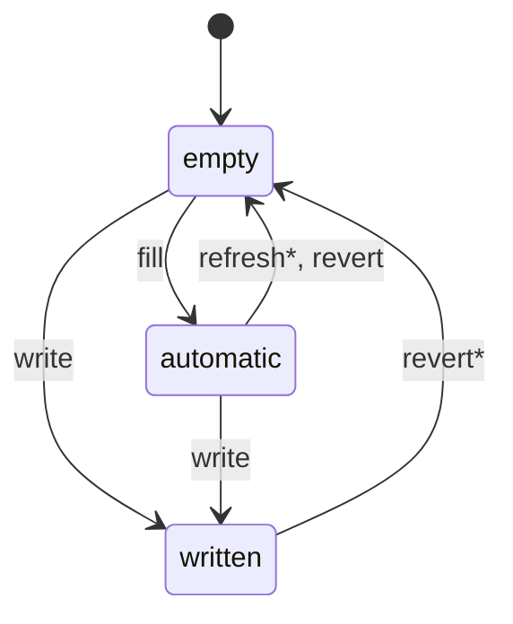

> Not drawn, since they keep the state: `refresh` of an `automatic` note while its duplicate remains (the text follows the duplicate), and `write` on a `written` note

> `refresh` goes to `empty` when the duplicate is gone. `revert` works from `written` only when the text is exactly the
> automatic one (a note saved before the marker existed)

| State | Meaning |
|---|---|
| `empty` | No note, or one that was reverted. The next duplicate fills it |
| `automatic` | The text `duplicateNote` wrote. It follows the latest duplicate as position, company and date change |
| `written` | The user typed in the field, even if they cleared it again. The warning never touches it |

| Move | Made by |
|---|---|
| `fill` | `suggestNote`, when an empty note has a duplicate to write from |
| `refresh` | `suggestNote`, when the duplicate of an automatic note changes (a list move: `automatic` or `empty`) |
| `write` | `setField("notes", …)`, on every edit of the field |
| `revert` | The warning's undo button (`revertDuplicate`) |

- **Starting state.** `noteStateOf(job)`, next to the table: `empty` without a note, `automatic` when the saved `notes_auto` is true,
  `written` otherwise. The form then fills an empty note, or refreshes an automatic one, as it opens.
- **Saving.** `notes_auto` is sent as true only in `automatic`. The backend's `NOTE` table stores it.
- **Reverted warning.** After a revert the warning stays hidden, and an empty note stays empty, for that position and
  company (`revertedKey`). A different pair brings both back.

## Application status journey (`APPLICATION_STATUS`)

The same table as the backend's
[`APPLICATION_STATUS`](../backend/STATE_MACHINES.md#application-status-journey-application_status): which status may
follow which in an application's steps. The server checks every rule again; the frontend uses the table to offer only
what the server will accept.

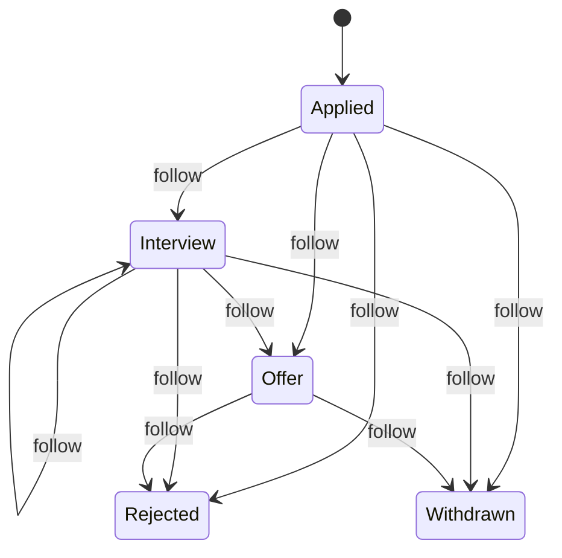

| Helper | Used for |
|---|---|
| `menuOptions(steps, index)` | A page's status menu. The current page's menu adds a step: it offers what may follow, "Another interview" for Interview → Interview, and "Undo …" when a step comes before it. At `MAX_STEPS` (10) only Undo is enabled. An earlier page's menu changes that step: it offers what `allowedAt` allows between its neighbors. The rest is greyed out |
| `allowedAt(steps, index)` | The statuses a step may have: Applied for the first, otherwise what may follow the step before it and be followed by the step after it |
| `removeBlocked(steps, index)` | Why a step's × is off: the first step is never removed, and a middle one only when its neighbors may follow each other |
| `dateBounds`, `checkDate` | The date box: between the neighbors' dates, never after today; Save only for a new valid date |
| `formStatuses(steps)` | The form's Status field: the current status, or one that may follow it (saving a new one adds a step) |
| `STATUSES`, `FIRST_STATUS`, `MAX_STEPS` | The table's states, its first state and the cap; `lib/api.js` re-exports `STATUSES` |

- **Mirrors the backend.** Change both tables together (see "Backend tables" below).
- **Saving.** [`hooks/useStepSaves.js`](src/hooks/useStepSaves.js) sends each change through `lib/api.js` (`addStep`,
  `changeStep`, `removeStep`). It shows the change at once with the copies in `utils/applications/journeyEdits.js`,
  then takes the server's answer. When a save fails, the card goes back to how it was and the page's error alert shows
  the server's message. While a card is saving, its controls are off (`savingIds`, the status area's `busy`).
- **Email updates.** A saved change reloads the email updates (`onSaved`), since a new current step can take away an
  update's Undo. A failed accept, dismiss or undo reloads them too, so an update that no longer applies loses its
  buttons; its message shows in the section it was clicked in.

## Status area folds (`STATUS_STACK`)

A card's status area is a stack of pages, one per step, the current status on top. The table says whether the card is
folded back to an earlier step.

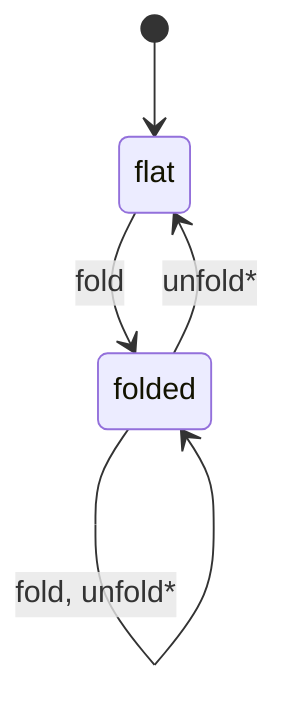

> `unfold` is a list move: `folded` while pages stay folded, `flat` once the current status is on top again

| Move | Made by |
|---|---|
| `fold` | The folded corner (`foldNext`): the top page folds back one step and stays folded |
| `unfold` | A strip (desktop), Escape, a click on the card, or another card folding (`unfoldTo`, `returnTo`) |

- **Data.** Which pages are folded is kept by step ID (`turnedIds`), so removing a step, or a server ID replacing a
  temporary one, keeps the right pages folded.
- **One folded card.** `Applications.jsx` keeps `foldedId`. Folding a card sets it, which unfolds any other (its
  `folded` prop turns false). A click or tap on a folded card returns it to the current status; on a phone, only a
  tap on an unfolded card opens the editor.
- **Screen readers.** Folding and unfolding are announced in the area's `aria-live` text.

## Status area page actions (`STEP_ACTION`)

An action on one page of the status area, asked first with an inline confirm in place of the page's controls.

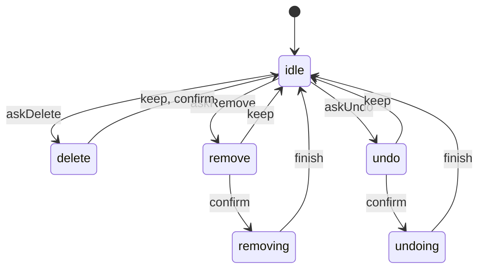

| State | Opened by | Shows | Confirm |
|---|---|---|---|
| `delete` | The current page's × | "Delete this application?" | Deletes the application |
| `remove` | An earlier page's × | "Remove Interview?" | `removing`: the page fades out (0.2s), then the step is removed |
| `undo` | "Undo …" in the current page's menu | "Back to Applied?" | `undoing`: the page folds away, then the step is removed |

- **Data.** `actionId` is the step whose page the action is on.
- **One at a time.** While a removal or an undo runs, nothing new can be asked and Keep isn't offered (`ask` checks
  the table first), and the pages don't fold or unfold (`actionUnderWay`, a state with a `finish` move). Folding, or
  opening a date, closes a confirm that's only asking.
- **Focus.** Keep returns focus to the × that asked; after a removal or an undo it goes to the status menu of the step
  before, which is now on top.

## Jobs page dialogs (`JOB_MODAL`)

The Jobs page shows one dialog at a time.

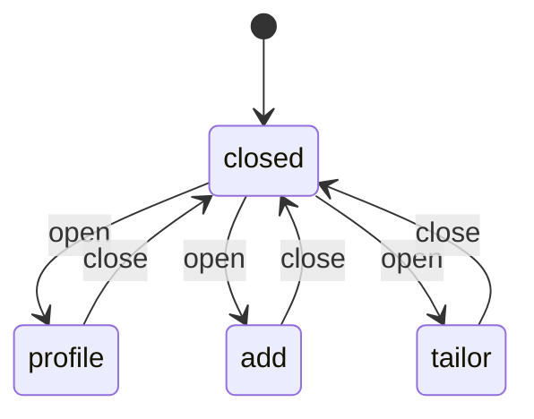

| State | Dialog | Opened by |
|---|---|---|
| `profile` | `ProfileModal` | Your Profile, or Upload your resume when there's no profile yet |
| `add` | `AddJobModal` | New job post |
| `tailor` | `TailorModal` | A job card's tailor button |

- **The tailored job.** `modalJob` holds the job the `tailor` dialog shows. `updateJob()` keeps it in sync with the list.
- **Profile saves.** Saving the profile closes its dialog. Grade sheet changes keep it open.
- **Searches.** Job searches aren't a table here: the page polls every 5 seconds while the server reports `running`
  (the backend's `SEARCH` table).

## Tailored resume (`TAILOR`)

The tailored resume in `TailorModal` for one job.

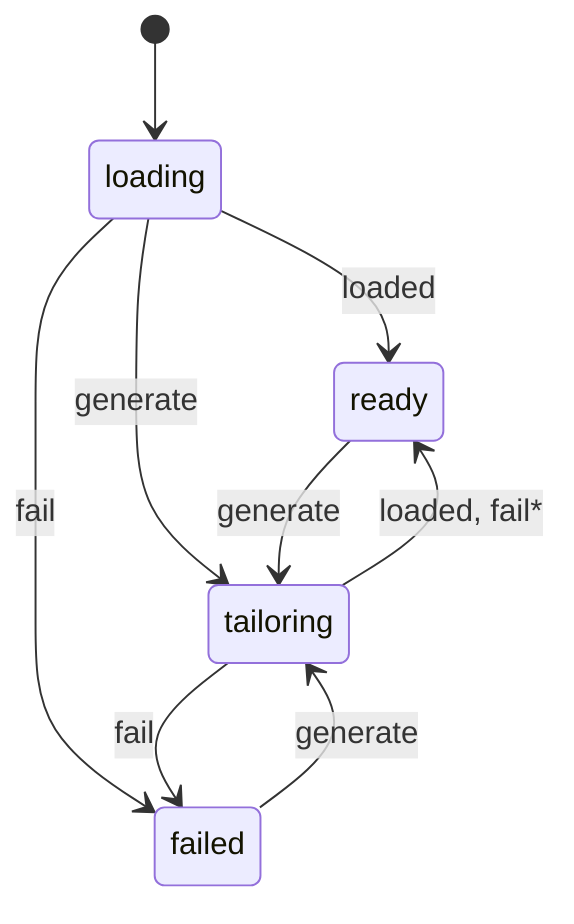

> `fail` returns to `ready` when a resume was already showing, and goes to `failed` when there was none

| State | Shows |
|---|---|
| `loading` | "Loading…" while the saved tailoring loads; with none saved, it tailors one right away (`generate`) |
| `tailoring` | "Tailoring your resume to this job…" |
| `ready` | The editor, changes, gaps and download, save and apply buttons |
| `failed` | Try again (`generate`) |

- **Failures.** A failed tailoring returns to `ready` when a resume was already showing, so a failed Regenerate keeps
  the last one. The error shows above it.
- **What `ready` doesn't track.** Unsaved edits (`dirty`) and the button in progress (`busy`: download, save, apply)
  are plain state within `ready`, not part of the table.

## Profile resume and grade sheet (`RESUME_FILE`, `GRADE_SHEET`)

`ProfileModal` has two independent tables, because the grade sheet uploads and removes on its own while the resume
is read or saved.

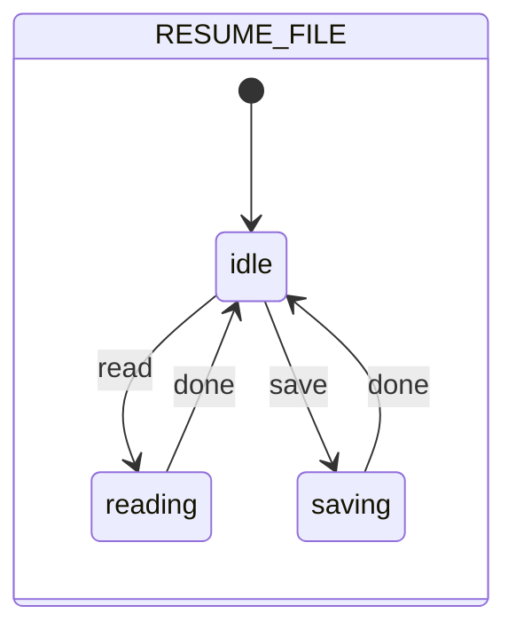

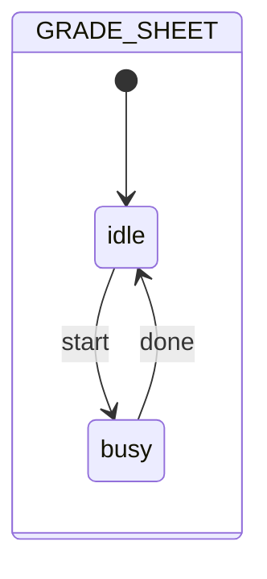

| State | UI |
|---|---|
| `reading` | A spinner replaces the upload button; the editor and Save are hidden or disabled |
| `saving` | Save shows "Saving…"; the resume upload button is disabled |
| `busy` (grade sheet) | The grade sheet's upload and remove buttons are disabled |

> • Reading and saving never overlap<br>
> • `done` runs in a `finally`, so the state returns to `idle` on errors too

## Adding or changing a table

1. **Put the table** in the feature's `utils/<feature>/*Machines.js`, with a comment saying what it tracks.
2. **Use it** in the component with `useMachine`, and keep any data that goes with the state next to it.
3. **Tests.** Add or update the table's tests in that folder's `__tests__/`.
4. **Backend tables.** If the table mirrors a backend one (the sign-in steps and `APPLICATION_STATUS` do), change both
   together.
5. **This page.** Update it.
